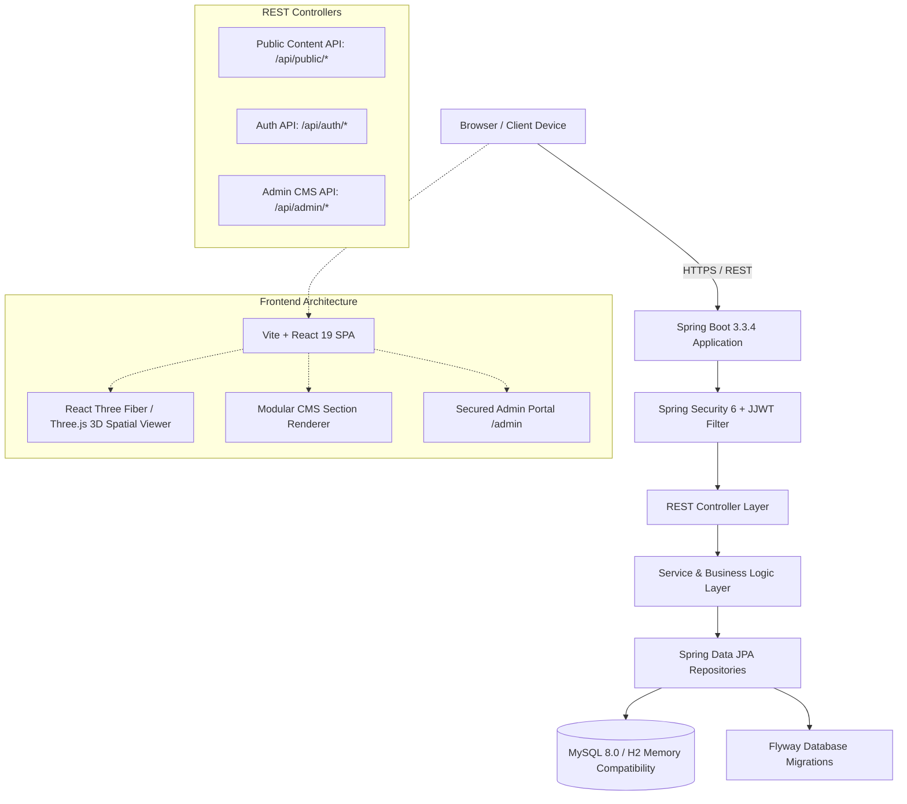

# Elysian Estates — System Architecture & Design Documentation

## 1. Executive Architecture Overview

**Elysian Estates** is an enterprise-grade luxury real estate web platform featuring immersive WebGL/Three.js 3D spatial experiences and a fully dynamic Content Management System (CMS). Built with **Spring Boot 3 (Java 21/25)** on the backend and **React 19 + TypeScript + Vite + Tailwind CSS v4** on the frontend, the platform decouples public presentation from editorial governance.

---

## 2. Backend Architecture

### 2.1 Technology Stack
- **Language & Runtime:** Java 21 / 25
- **Framework:** Spring Boot 3.3.4
- **Persistence:** Spring Data JPA / Hibernate 6
- **Database Engine:** MySQL 8.0 (Production) / H2 in MySQL Compatibility Mode (Zero-setup Dev)
- **Migrations:** Flyway (`V1__init_schema.sql`, `V2__seed_initial_data.sql`)
- **Security:** Spring Security 6 with stateless JWT (`jjwt-api 0.12.6`) and BCrypt password hashing
- **Documentation:** Springdoc OpenAPI 2.6.0 (Swagger UI at `/swagger-ui.html`)

### 2.2 Domain Packaging Strategy
The application follows a clean domain-driven package layout under `com.realestate.aura`:
- `auth`: Credentials verification, token issuance, authentication response DTOs.
- `common`: Generic wrappers (`ApiResponse<T>`, `PagedResponse<T>`), public content aggregators.
- `config`: Security filters, CORS rules, OpenAPI Swagger definition.
- `exception`: Global advice exception handlers (`ResourceNotFoundException`, `BadRequestException`).
- `security`: `JwtAuthenticationFilter`, `JwtTokenProvider`, `UserPrincipal`, `CustomUserDetailsService`.
- `property`: Real estate listings, pricing, specs, images, amenities catalog, 3D model links.
- `project`: Masterplanned developments, handover dates, unit types, starting prices.
- `location`: Districts and luxury neighborhoods (Downtown Dubai, Palm Jumeirah, Dubai Marina, etc.).
- `developer`: Master developers (Emaar, Omniyat, Meraas, Nakheel).
- `page`: Dynamic CMS pages and modular section blocks (`Page`, `PageSection`).
- `cms`: Audit logs and snapshot version rollback (`ContentRevision`).
- `media`: Centralized media assets and external resource registration (`MediaAsset`).
- `navigation`: Dynamic header and footer menus (`NavigationItem`).
- `settings`: Global site branding, VIP concierge contacts, currency defaults (`WebsiteSetting`).
- `enquiry`: Client leads pipeline, VIP tour schedules, private agent notes (`Enquiry`, `ViewingRequest`).
- `blog`: Real estate journal articles and market intelligence (`BlogPost`, `BlogCategory`).
- `testimonial` & `team`: Client endorsements and leadership directory.
- `dashboard`: Real-time KPI analytics and stats (`DashboardStatsDto`).

---

## 3. Frontend Architecture

### 3.1 Technology Stack
- **Build Tool:** Vite 6
- **Framework:** React 19 + TypeScript
- **Styling:** Tailwind CSS v4 (`@tailwindcss/vite` engine)
- **3D Spatial Graphics:** Three.js / React Three Fiber (`@react-three/fiber`, `@react-three/drei`)
- **Icons:** Lucide React
- **Routing:** React Router v7 (`react-router-dom`)
- **State Management:** React Context (`AuthContext`, `SettingsContext`)

### 3.2 3D Spatial Viewer Architecture
The 3D module (`Property3DViewer.tsx`) is designed for maximum resilience:
1. **Model Loader:** Uses `@react-three/drei`'s `useGLTF` to stream binary GLTF/GLB architectural files.
2. **Environment & Lighting:** Features preset switchers (Daylight, Golden Hour Luxury Sunset, Dramatic Night Studio) with soft shadows and contact shadow planes.
3. **Graceful Fallback:** If WebGL fails, the model is missing, or the device lacks GPU power, the component automatically degrades to high-resolution architectural photography with zero page breakage.

---

## 4. Role-Based Access Control (RBAC) Matrix

| Security Role | Description | Allowed Endpoints & Features |
|---|---|---|
| `ROLE_SUPER_ADMIN` | Complete governance | Full access including staff management (`/admin/users`) and audit logs |
| `ROLE_ADMIN` | Platform operations | Properties CRUD, developments, settings, inquiries, media, navigation |
| `ROLE_CONTENT_MANAGER` | Marketing & editorial | CMS Page Builder (`/admin/pages`), revisions, journal articles, media |
| `ROLE_AGENT` | Brokerage & client relations | Properties catalog view, leads management, private tour scheduling |
| *Public (Anonymous)* | Website visitors | Public endpoints (`/api/public/*`), authentication (`/api/auth/login`) |
